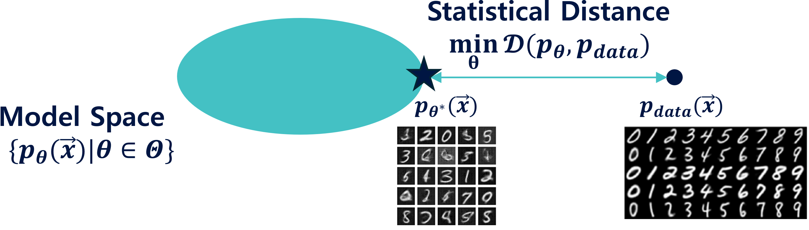

# Deep Generative Models: A Statistical Perspective

## Instructor & Course Development Team Information
**Instructor:** Young-geun Kim (Department of Mathematical Sciences, UNIST)  
**Homepage:** [https://kyg0910.github.io/](https://kyg0910.github.io/)  
**Program Developers:** Drs. Young-geun Kim and Jaejun Yoo  
**Teaching Assistants:** Jeongyun Ha, Sangyeop Yeo, and Gunha Hong  

## Course Overview
This course, *MTH345: Deep Generative Models: A Statistical Perspective* at the Ulsan National Institute of Science and Technology (UNIST), provides a comprehensive understanding of deep generative models and statistical machine learning methods used to model and synthesize complex, high-dimensional data. Starting from the foundations of probability theory and maximum likelihood estimation, the course explores modern generative modeling paradigms through the lens of targeted statistical distances, including f-divergences, integral probability metrics (IPMs), Wasserstein distances, and Fisher divergences.

Useful related resources include:
- [[STT997: Deep Generative Model: A Statistical Perspective]](https://github.com/kyg0910/-STT997-Deep-Generative-Model/tree/main), a Ph.D.-level graduate course held at Michigan State University and taught by Dr. Young-geun Kim.
- [[MTH344: Mathematical Statistics]](https://github.com/kyg0910/MTH344-Mathematical-Statistics), an undergraduate course held at UNIST and taught by Dr. Young-geun Kim.

## Objectives
- Understand the probabilistic and statistical foundations of deep generative models.
- Explore how different statistical distances motivate key transitions in the generative model literature.

## Lecture Topics
| Module & Topic | Download Course Material | Key Reference |
| :--- | :--- | :--- |
| **Intro.** Course Introduction | [[Syllabus]](https://raw.githubusercontent.com/kyg0910/DeepGenerativeModel-A-Statistical-Perspective/main/Syllabus.pdf) [[Lecture Note]](https://raw.githubusercontent.com/kyg0910/DeepGenerativeModel-A-Statistical-Perspective/main/lecture%20notes/Chapter%200_Introduction.pdf) | |
| **M1. Foundations of Probabilistic Modelling** | | |
| 1. Fundamentals of Probability Theory | [[Lecture Note]](https://raw.githubusercontent.com/kyg0910/DeepGenerativeModel-A-Statistical-Perspective/main/lecture%20notes/Chapter%201_Fundamentals%20of%20Probability%20Theory.pdf) | [1, 2, 3] |
| 2. Random Variables | [[Lecture Note]](https://raw.githubusercontent.com/kyg0910/DeepGenerativeModel-A-Statistical-Perspective/main/lecture%20notes/Chapter%202_Random%20Variables.pdf) | [1, 2, 3] |
| 3. Likelihood Maximization Principle | [[Lecture Note]](https://raw.githubusercontent.com/kyg0910/DeepGenerativeModel-A-Statistical-Perspective/main/lecture%20notes/Chapter%203_Likelihood%20Maximization%20Principle.pdf) | [3] |
| 4. Basics of Probabilistic Modelling | [[Lecture Note]](https://raw.githubusercontent.com/kyg0910/DeepGenerativeModel-A-Statistical-Perspective/main/lecture%20notes/Chapter%204_Basics%20of%20Probabilistic%20Modelling.pdf) | [4, 5] |
| **M2. Likelihood Ratio-based Generative Models** | | |
| 5. Autoregressive Model | [[Lecture Note]](https://raw.githubusercontent.com/kyg0910/DeepGenerativeModel-A-Statistical-Perspective/main/lecture%20notes/Chapter%205_Autoregressive%20Model.pdf) | [6, 7] |
| 6. Energy-based Model | [[Lecture Note]](https://raw.githubusercontent.com/kyg0910/DeepGenerativeModel-A-Statistical-Perspective/main/lecture%20notes/Chapter%206_Energy-based%20Model.pdf) | [7, 8] |
| 7. Variational Autoencoder | [[Lecture Note]](https://raw.githubusercontent.com/kyg0910/DeepGenerativeModel-A-Statistical-Perspective/main/lecture%20notes/Chapter%207_Variational%20Autoencoder.pdf) | [7, 9, 10] |
| 8. Generative Adversarial Network | [[Lecture Note]](https://raw.githubusercontent.com/kyg0910/DeepGenerativeModel-A-Statistical-Perspective/main/lecture%20notes/Chapter%208_Generative%20Adversarial%20Network.pdf) | [7, 11] |
| **M3. Generative Models with Other Statistical Distance** | | |
| 9. Integral Probability Metric-based Approaches 10. Wasserstein Distance-based Approaches 11. Score-based Approaches | [[Lecture Note (M3: Ch. 9-11)]](https://raw.githubusercontent.com/kyg0910/DeepGenerativeModel-A-Statistical-Perspective/main/lecture%20notes/Module%203_Generative%20Models%20with%20Other%20Statistical%20Distance.pdf) | [12] [13, 14] [15, 16] |
| **Supplementary Material** | | |
| PyTorch Implementation (Tutorial, VAE, and DCGAN) | [[Lecture Note]](https://raw.githubusercontent.com/kyg0910/DeepGenerativeModel-A-Statistical-Perspective/main/lecture%20notes/Supplementary_PyTorch_Implementation.pdf) [[Code (Tutorial)]](https://github.com/kyg0910/-STT997-Deep-Generative-Model/blob/main/code/IV.%20Preliminary%20Knowledge%20-%20Python%20and%20PyTorch.ipynb) [[Code (VAE)]](https://github.com/kyg0910/-STT997-Deep-Generative-Model/blob/main/code/STT997_VAE_MNIST.ipynb) | [17] |

## Course Videos (Pilot Course Archive)

Course recordings from the pilot offering are available in two formats (currently provided via the campus network, and will be released on [[STAR-MOOC]](https://www.starmooc.kr/) later):

<ins>1) Standard Video + Separate Subtitles</ins>: Please download both the video and subtitle files. You can enable the subtitles by clicking the 'Language and subtitle' button or by using the shortcut `Ctrl + L`.

<ins>2) Subtitle-Embedded Video</ins>: Subtitles are permanently embedded into the video file, so no additional setup or separate files are required.

| Lecture | Video | Subtitle | Download Pilot Materials |
| :---: | :---: | :---: | :--- |
| Week 1 | [[Video]](https://10.74.51.22:5055/sharing/4OiHOS1xD) | [[Subtitle]](https://10.74.51.22:5055/sharing/82jp7pIVo) | [[Syllabus]](https://raw.githubusercontent.com/kyg0910/DeepGenerativeModel-A-Statistical-Perspective/main/Syllabus.pdf) [[Chapter 0_Introduction]](https://raw.githubusercontent.com/kyg0910/DeepGenerativeModel-A-Statistical-Perspective/main/lecture%20notes/Chapter%200_Introduction.pdf) [[Chapter 1_Fundamentals of Probability Theory]](https://raw.githubusercontent.com/kyg0910/DeepGenerativeModel-A-Statistical-Perspective/main/lecture%20notes/Chapter%201_Fundamentals%20of%20Probability%20Theory.pdf) [[Chapter 2_Random Variables (Part I)]](https://raw.githubusercontent.com/kyg0910/DeepGenerativeModel-A-Statistical-Perspective/main/lecture%20notes/Chapter%202_Random%20Variables%20(Part%20I).pdf) |
| Week 2 | [[Video]](https://10.74.51.22:5055/sharing/d2o4elHhi), [[Video(Embedded)]](https://10.74.51.22:5055/sharing/64QH9oaWg) | [[Subtitle]](https://10.74.51.22:5055/sharing/wOFZKm3w2) | [[Pilot Lecture 2_Learning Objective]](https://raw.githubusercontent.com/kyg0910/DeepGenerativeModel-A-Statistical-Perspective/main/learning%20objective/Pilot%20Lecture%202_Learning%20Objective.pdf) [[Chapter 2_Random Variables (Part II)]](https://raw.githubusercontent.com/kyg0910/DeepGenerativeModel-A-Statistical-Perspective/main/lecture%20notes/Chapter%202_Random%20Variables%20(Part%20II).pdf) [[Chapter 3_Statistical Estimation and Hypothesis Testing]](https://raw.githubusercontent.com/kyg0910/DeepGenerativeModel-A-Statistical-Perspective/main/lecture%20notes/Chapter%203_Statistical%20Estimation%20and%20Hypothesis%20Testing.pdf) |
| Week 3 | [[Video(Embedded)]](https://10.74.51.22:5055/sharing/deINiu0Kg) | Embedded in [[Video(Embedded)]](https://10.74.51.22:5055/sharing/deINiu0Kg) | [[Pilot Lecture 3_Learning Objective]](https://raw.githubusercontent.com/kyg0910/DeepGenerativeModel-A-Statistical-Perspective/main/learning%20objective/Pilot%20Lecture%203_Learning%20Objective.pdf) [[Chapter 4_Basics of Probabilistic Modelling]](https://raw.githubusercontent.com/kyg0910/DeepGenerativeModel-A-Statistical-Perspective/main/lecture%20notes/Chapter%204_Basics%20of%20Probabilistic%20Modelling.pdf) |
| Week 4 | [[Video 1]](https://10.74.51.22:5055/sharing/EUwzzcf7k) [[Video 2]](https://10.74.51.22:5055/sharing/Lt34Sm7C8) | [[Subtitle 1]](https://10.74.51.22:5055/sharing/iKl7uhFfx) [[Subtitle 2]](https://10.74.51.22:5055/sharing/TCYasIqB4) | [[Pilot Lecture 4_Learning Objective]](https://raw.githubusercontent.com/kyg0910/DeepGenerativeModel-A-Statistical-Perspective/main/learning%20objective/Pilot%20Lecture%204_Learning%20Objective.pdf) [[Chapter 5_Autoregressive Model]](https://raw.githubusercontent.com/kyg0910/DeepGenerativeModel-A-Statistical-Perspective/main/lecture%20notes/Chapter%205_Autoregressive%20Model.pdf) [[Chapter 6_Energy-based Model]](https://raw.githubusercontent.com/kyg0910/DeepGenerativeModel-A-Statistical-Perspective/main/lecture%20notes/Chapter%206_Energy-based%20Model.pdf) |
| Week 5 | [[Video(Embedded)]](https://10.74.51.22:5055/sharing/aoIrV720h) [[Video 1]](https://10.74.51.22:5055/sharing/rhpkUK8Xm) [[Video 2]](https://10.74.51.22:5055/sharing/7BnHLL30l) | Embedded in [[Video(Embedded)]](https://10.74.51.22:5055/sharing/aoIrV720h) | [[Pilot Lecture 5_Learning Objective]](https://raw.githubusercontent.com/kyg0910/DeepGenerativeModel-A-Statistical-Perspective/main/learning%20objective/Pilot%20Lecture%205_Learning%20Objective.pdf) [[Chapter 7_Variational Autoencoder]](https://raw.githubusercontent.com/kyg0910/DeepGenerativeModel-A-Statistical-Perspective/main/lecture%20notes/Chapter%207_Variational%20Autoencoder.pdf) |
| Week 6 | [[Video 1]](https://10.74.51.22:5055/sharing/dyfAj0PY7) [[Video 2]](https://10.74.51.22:5055/sharing/wKnPCaQ5J) | [[Subtitle 1]](https://10.74.51.22:5055/sharing/V9AsBGzjp) [[Subtitle 2]](https://10.74.51.22:5055/sharing/a0RXDJOgG) | [[Pilot Lecture 6_Learning Objective]](https://raw.githubusercontent.com/kyg0910/DeepGenerativeModel-A-Statistical-Perspective/main/learning%20objective/Pilot%20Lecture%206_Learning%20Objective.pdf) [[Chapter 8_Generative Adversarial Network]](https://raw.githubusercontent.com/kyg0910/DeepGenerativeModel-A-Statistical-Perspective/main/lecture%20notes/Chapter%208_Generative%20Adversarial%20Network.pdf) |
| Week 7 | [[Video 1]](https://10.74.51.22:5055/sharing/sRpiC6mQA) [[Video 2]](https://10.74.51.22:5055/sharing/d5DQQ2WHv) | [[Subtitle 1]](https://10.74.51.22:5055/sharing/l2gvSIhHW) [[Subtitle 2]](https://10.74.51.22:5055/sharing/lxmJSGQgs) | [[Pilot Lecture 7_Learning Objective]](https://raw.githubusercontent.com/kyg0910/DeepGenerativeModel-A-Statistical-Perspective/main/learning%20objective/Pilot%20Lecture%207_Learning%20Objective.pdf) [[Module 3_Generative Models with Other Statistical Distance]](https://raw.githubusercontent.com/kyg0910/DeepGenerativeModel-A-Statistical-Perspective/main/lecture%20notes/Module%203_Generative%20Models%20with%20Other%20Statistical%20Distance.pdf) |
| Week 8 | - | - | [[Group Presentation]](https://raw.githubusercontent.com/kyg0910/DeepGenerativeModel-A-Statistical-Perspective/main/group%20presentation.pdf) |

## References
[1] Deisenroth, M. P., Faisal, A. A., and Ong, C. S. (2020). *Mathematics for machine learning*. Cambridge University Press.  
[2] Ross, S. M. (2020). *A first course in probability*. Pearson.  
[3] Rice, J. A. (2007). *Mathematical statistics and data analysis*. Thomson/Brooks/Cole.  
[4] Efron, B. (1975). The efficiency of logistic regression compared to normal discriminant analysis. *Journal of the American Statistical Association*, 70(352):892-898.  
[5] Hastie, T., Tibshirani, R., and Friedman, J. (2009). *The elements of statistical learning: data mining, inference, and prediction*. Springer.  
[6] Uria, B., Côté, M.-A., Gregor, K., Murray, I., and Larochelle, H. (2016). Neural autoregressive distribution estimation. *Journal of Machine Learning Research*, 17(205):1-37.  
[7] Goodfellow, I. (2016). NIPS 2016 tutorial: Generative adversarial networks. *arXiv preprint arXiv:1701.00160*.  
[8] Hinton, G. E. (2002). Training products of experts by minimizing contrastive divergence. *Neural Computation*, 14(8):1771-1800.  
[9] Kingma, D. P. and Welling, M. (2014). Auto-encoding variational Bayes. In *Proceedings of the International Conference on Learning Representations (ICLR)*.  
[10] Kingma, D. P. and Welling, M. (2019). An introduction to variational autoencoders. *Foundations and Trends® in Machine Learning*, 12(4):307-392.  
[11] Goodfellow, I., Pouget-Abadie, J., Mirza, M., Xu, B., Warde-Farley, D., Ozair, S., Courville, A., and Bengio, Y. (2014). Generative adversarial nets. *Advances in Neural Information Processing Systems*, 27.  
[12] Gretton, A., Borgwardt, K. M., Rasch, M. J., Schölkopf, B., and Smola, A. (2012). A kernel two-sample test. *Journal of Machine Learning Research*, 13(1):723-773.  
[13] Santambrogio, F. (2015). *Optimal transport for applied mathematicians: Calculus of variations, PDEs, and modeling*. Birkhäuser.  
[14] Arjovsky, M., Chintala, S., and Bottou, L. (2017). Wasserstein generative adversarial networks. In *International Conference on Machine Learning*, pages 214-223. PMLR.  
[15] Hyvärinen, A. (2005). Estimation of non-normalized statistical models by score matching. *Journal of Machine Learning Research*, 6(4):695-709.  
[16] Ho, J., Jain, A., and Abbeel, P. (2020). Denoising diffusion probabilistic models. *Advances in Neural Information Processing Systems*, 33:6840-6851.  
[17] PyTorch Tutorials: [https://pytorch.org/tutorials/beginner/basics/intro.html](https://pytorch.org/tutorials/beginner/basics/intro.html)

## License
You can freely use and distribute the course materials and code, as long as you provide attribution to the original author and source.
